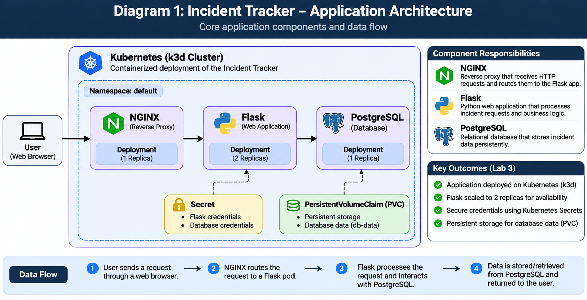
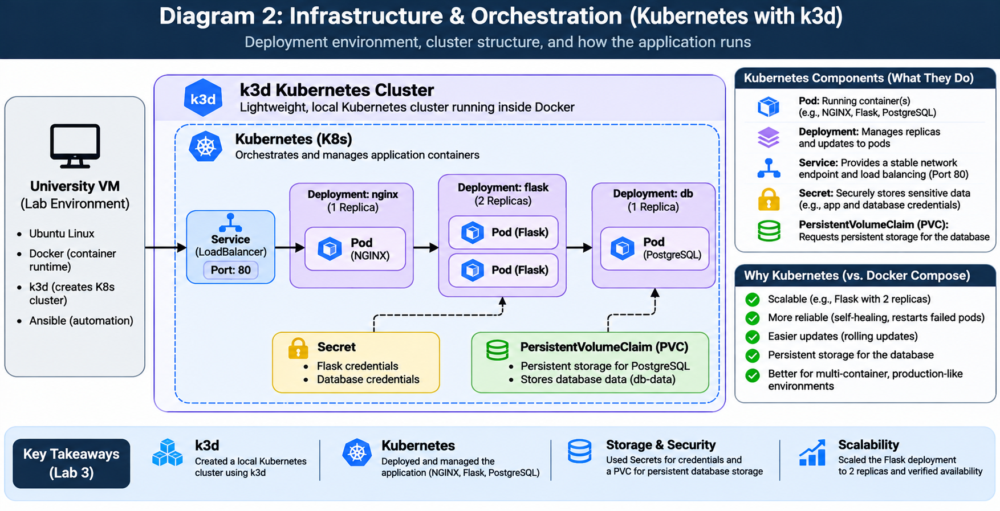
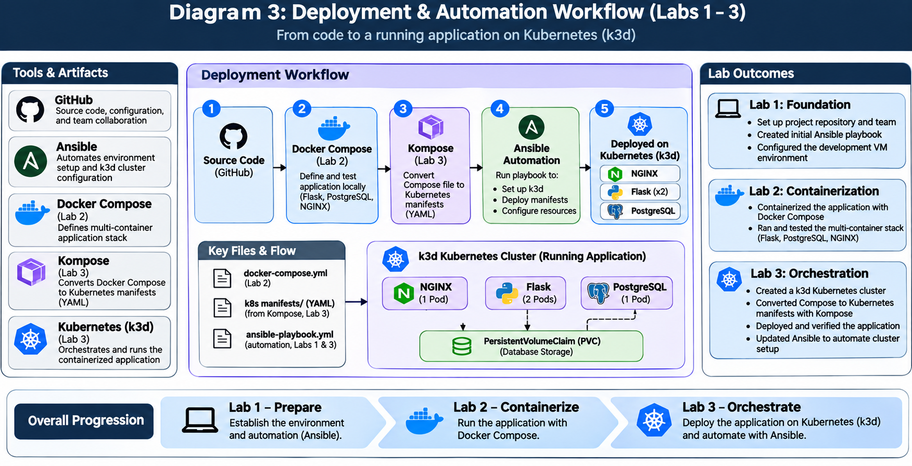

# INET-4031 TEAM 4 (The Technologist Masters)

### Link to our Project Sprint Board
- [Github Project](https://github.com/users/LincolnKoskela/projects/3)


### Environment

- OS: RHEL 9.8
- Tools: Docker 29.9.0, Ansible Core 2.14.18, Git
- Host: Shared university VM

### Lab 1: Environment & Team Setup / Ansible
Set up the Ansible environment. Created `ansible/site.yml` and pasted the playbook that automates installing linux packages, 
ansible, and docker. It starts docker, configs user permissions etc. It preps our envirnmt for future labs.

- Ansible playbook: Basically a set of instructions that automatically installs the tools we need and sets up Docker, so we don't have to do everything by hand.
- Why it's useful: If we ever had to start over with a fresh server, we'd already have the setup instructions saved in GitHub instead of figuring everything out again.

**Pass all checks**
```
chmod +x ./scripts/check-week1.sh
./scripts/check-week1.sh
```

No issues during this lab.

### Lab 2: Building the 3 tier stack application

**Summary**

In lab 1 we laid the foundation for the ansible playbook, told ansible where to run it's automations and
gave it the playbook to tell ansible what automations to do. It ensures the baseline environment is configured. 
In lab 2 we expanded on our project by first defining the three tier stack application services: nginx, flask, and postgreSQL. 
These definitions went inside the `docker-compose.yml` file. Then we added network and volume features to the `docker-compose.yml`. 
This enables the containers to talk to each other on their own private network while also provided volume is keeping the database records
safe. Lastly, we expanded ansible by making a folder called `app-stack` that will hold instructions to automatically start our application.
We're adding steps to ansible so eventually it can rebuild our application setup for us. Then we connect the `app-stack` to the playbook 

**Key words**

- Reverse Proxy: an intermediary; routes all incoming traffic request to their correct destination. 
- API: Application Programming Interface: a set of rules and protocols that allows different software applications to 
communicate and exchange data with each other.
- .yml file: a human-readable data serialization format. Commonly used for software config files.

- PostgreSQL Database: the database. Stores incident records. Must finish initializing before Flask can connect.
- Nginx: the API. Reads and writes incidents. Must be healthy before Nginx routes traffic to it.
- Flask: the reverse proxy. Handles incoming requests and forwards them to Flask. Comes up last.

**Validation**
```
chmod +x scripts/check-week2.sh
./scripts/check-week2.sh
```

No issues in this lab. Validation checks clean.


## Lab 3 - Container Orchestration with k3d

In this lab, we are moving incident tracking application from Docker Compose to Kubernetes.
Why? Becuase Kubernetes can manage application containers more effectively as they continue to grow. 
Our application doesn't necessarily need Kubernetes, but this is how companies manage in large 
production environments. 

Transitioning from Docker Compose to Kubernetes for container management, we first started by creating k3d clusters. 
k3d is a tool that creates and manages Kubernetes clusters. Then we converted Docker Compose configurations into 
Kubernetes manifest using a tool called Kompose. After that, we deployed our application. This means we made 
our application run in an environment where users can access it. This involved giving Kubernetes YAML manifest. 
Kubernetes creating pods to run containers. Exposing the application so users can access it through a web browser. 

We went from having application code and configuration files to having a working application running inside Kubernetes.

Lastly, we updated our Ansible playbook for future automation of k3d cluster setups. 


### Key words
- Docker Compose: Runs your application's containers using a Compose configuration.
- k3d: Creates a local Kubernetes cluster on your VM.
- Kompose: Converts your Docker Compose configuration into Kubernetes manifests (YAML files).
- Kubernetes: Takes over managing your application's containers.
- Ansible: Automates setting up k3d so you can repeat the process.
- Cluster: group of computers (nodes) that work together as one system.


## System Architecture





## Team Members

| Name | Email | GitHub Username | Current Role |
| ---- | ----- | --------------- | ------------ | 
| **Abdikarim** | Abdibmoha32@gmail.com | Abdibmoha32-star | Developer |
| **Mohamed** | mahad083@umn.edu | mahad083 | Sys Admin | 
| **Franklin** | franklin1jbradley@gmail.com | FranklinBrad | QA | 
| **Lincoln** | koske113@umn.edu | lincolnkoskela | Scrum Master | 
| **Kahiye** | kahin012@umn.edu | kahin012-cyber | Developer |
| **Mahir** | ismai164@umn.edu | -- | Developer |

## Links
- [TEAM Charter](TEAM_CHARTER.md)
- [Github Project](https://github.com/users/LincolnKoskela/projects/3)

## Google Docs

| Sprint # | Week | Doc | Sections | 
| -------- | ---- | --- | ---------| 
| Sprint 1| Week 1 | [Sprint 1](https://docs.google.com/document/d/18M1M-BXXiRc-_oAEJzN-DMDf3LAYOGaXO1BtKQHledY/edit?tab=t.0) | Lab 1 part 1 & 2 |
| Sprint 1| Week 2 | [Sprint 1](https://docs.google.com/document/d/15OqQ9wg6eAtSuQJsSK4ycqgn7YZe2qml4hF9kY_ykks/edit?tab=t.0) | Lab 1 part 3 && Lab 2 part 1 & 2 | 
| Sprint 1 | Week 3 | [Sprint 1](https://docs.google.com/document/d/1zbn7Vs36repbvgo8TzE_0WQ4cSWPTJu2vE7PpyH3DAo/edit?tab=t.0) | Lab 2 part 3 |
| Sprint 2 | Week 4 | [Sprint 2](https://docs.google.com/document/d/1CM4l-zpCr22cF59WCulq8-Z2I5JXKqWv3ZUrqZKwRf4/edit?tab=t.0) | Lab 3 | 
| Sprint 2 | Week 4 | [Sprint 2](https://docs.google.com/document/d/1X3Cch7b5BpypOXtlK-KE6l3pMkvsO5NedIFNNhzOf1s/edit?tab=t.0) | Lab 4 | 
| Sprint 3 | Week 5 | [Sprint 3](https://docs.google.com/document/d/1T7WB-vNLd0U6nvW2LPKlDWJchTMlT8eMmWoQWH7TV2E/edit?tab=t.0#heading=h.os0x1xy1p7cg)| Lab 5 | 
| Sprint 3 | Week 6 | [Sprint 3](https://docs.google.com/document/d/15DZgE2GE_X--YhF7GgfKfQlP69AeAfDqPXCMvig_A5o/edit?tab=t.0)| Lab 6 | 
| Sprint 4 | Week 7 | [Sprint 4](https://docs.google.com/document/d/14RIXpQIhEpLZlmqdWa7Cgoe7aNiOFlgJlE6BGDXg2gQ/edit?tab=t.0#heading=h.5krs08qd5ud9)| Lab 7 | 
| Sprint 4 | Week 8 | [Sprint 4](https://docs.google.com/document/d/1CogcPh87iZO-TxHJpWODKy0XHAYlg9g3YzIMFPQrhAY/edit?tab=t.0)| Lab 8 | 


